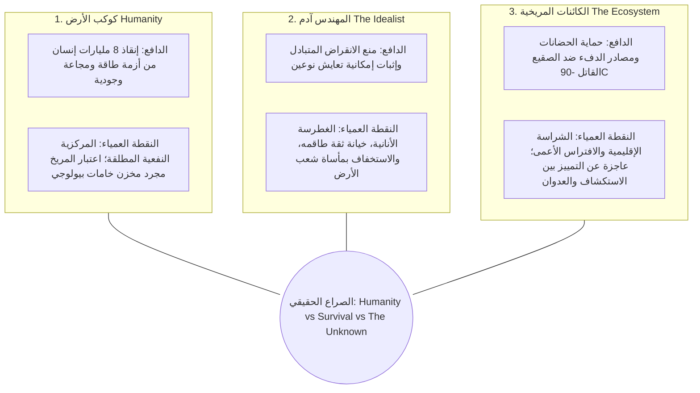
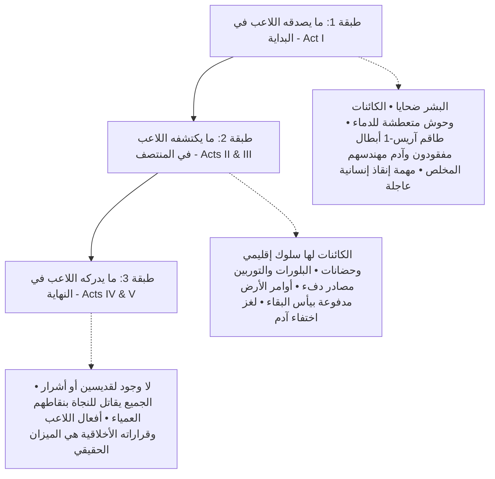
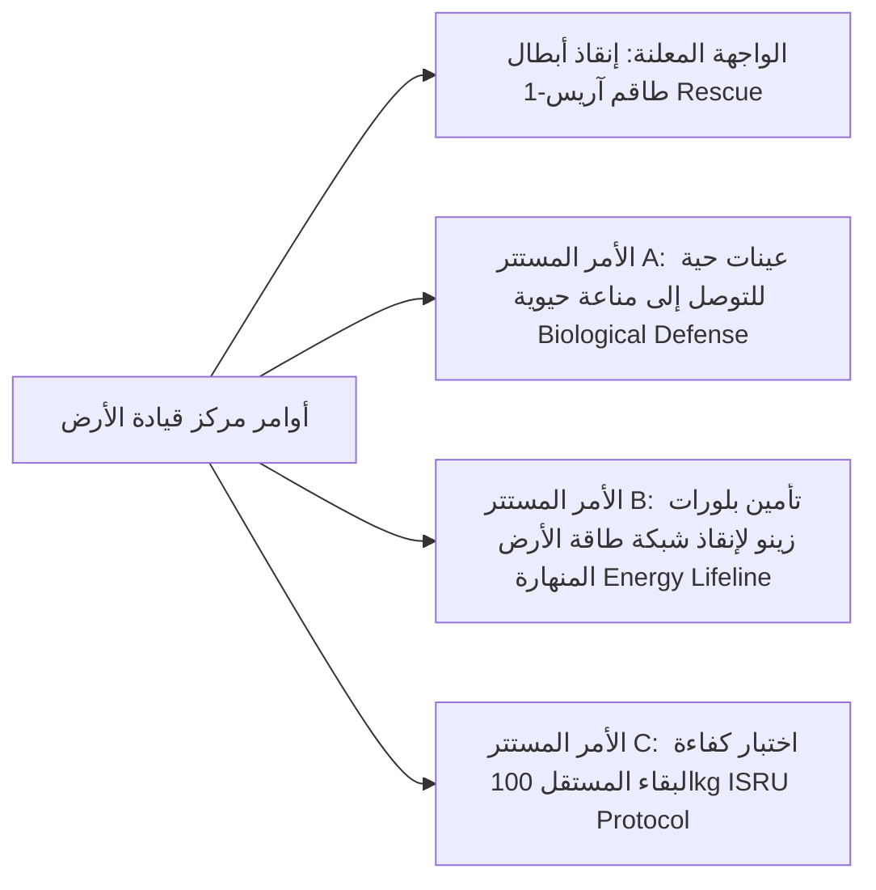
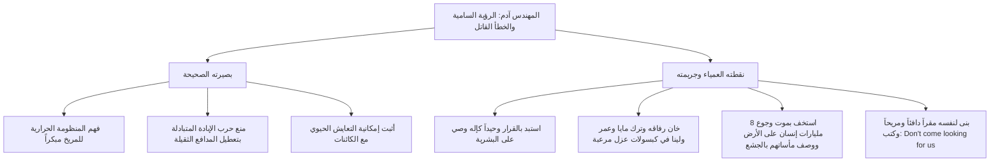
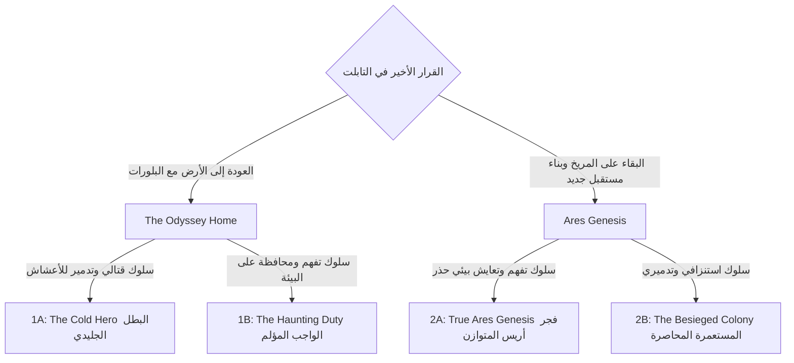

# 🚀 وثيقة تصميم وخطة تطوير اللعبة: رحلة المريخ (Astra: The Red Balance)
### Game Design Document & Narrative Master Plan

---

## ⚖️ 1. العمود الفقري الفلسفي للقصة: ثلاثية الدوافع والنقاط العمياء (The Triad of Survival)

### ❓ السؤال الوجودي الحقيقي للعبة:
> **"When two species fight to survive, who gets to decide who is the invader?"**  
> *(عندما يتقاتل كائنان في سبيل النجاة، من منهما يملك الحق في أن يقرر أن الآخر هو المعتدي؟)*

* **معنى العنوان "The Red Balance" (الميزان الأحمر):**  
  القصة ليست صراعاً تقليدياً بين "الخير والشر" أو "شركة جشعة ضد بطل صالح"، بل هي ميزان بقاء حرج ومتأرجح:  
  $$\text{Human Survival} \iff \text{Martian Balance} \iff \text{The Unknown}$$  
  وقرارات القائد في كل خطوة ميدانية هي التي تحدد أين سيميل كف هذا الميزان!

---

### 🔺 ثلاثية الدوافع المشروعة والنقاط العمياء (The Motivation & Blind Spot Triad):

> ⚠️ **القاعدة الذهبية المانعة للسطحية السردية (The Anti-Cliché Rule):**  
> **إياك أن تتحول القصة إلى "الأرض شريرة + آدم قديس على حق + الكائنات ملائكية مسالمة".**  
> هذا ينسف كل العمق ويعيدنا لقصص الخير والشر الكرتونية. في *Astra*، **كل طرف يملك دافعاً مشروعاً ومفهوماً للنجاة، لكن كل طرف يملك أيضاً نقطة عمياء قاتلة (Blind Spot):**



| الطرف | الدافع المفهوم والمشروع (Legitimate Motive) | النقطة العمياء القاتلة (Fatal Blind Spot) | النتيجة السردية على الأرض |
| :--- | :--- | :--- | :--- |
| 🌍 **كوكب الأرض (Earth)** | **أزمة بقاء وجودية حقيقية:** الأرض تحتضر بسبب انهيار مناخي ومجاعة ونفاد مصادر الطاقة لـ 8 مليارات إنسان. بلورات زينو ليست تجارة رفاهية، بل شريان الحياة لتدفئة مدن كاملة ومنع شتاء ديموغرافي مميت. | **المركزية النفعية المتطرفة (Utilitarian Anthropocentrism):** عجزهم عن رؤية أي قيمة للحياة خارج نفعها للبشر. يعتبرون أي كائن حي مجرد مورد يجب استخراجه أو عائق يجب إبادته. | تجبر القائد على اتخاذ إجراءات استنزاف سريعة باسم الواجب القومي الإنساني. |
| 👨‍🔧 **المهندس آدم (Adam)** | **البصيرة البيئية ومنع الإبادة:** أدرك الترابط الدقيق لكائنات المريخ وحرارتها، وعرف أن حرب التسليح ستدمر الكوكب وتفني النوعين (*Mutual Extinction*). أراد إنقاذ فرصة التعايش الأولى في تاريخ الفضاء. | **الغطرسة الفردية والاستعلاء الأخلاقي (Hubris & Moral Detachment):** نصب نفسه إلهاً وحيداً يقرر مصير البشرية دون إذن. خان رفاقه، تركهم محتجزين في كبسولات رعب، ونبذ مليارات الجياع على الأرض بوصفهم "مستغلين" وهو ينعم بدافء معقله. | مواجهته في نهاية اللعبة ليست مع بطل حكيم، بل مع رفيق تائه تلوثت مثاليته بالخيانة والأنانية. |
| 🦂 **الكائنات المريخية (The Organisms)** | **غريزة البقاء النقية في صقيع المريخ:** كائنات طورت سلوكها عبر ملايين السنين للبقاء في درجة حرارة -90°C. التشبث بالحرارة وحماية البيوض والحضانات هو قانون وجودها الوحيد. | **الشراسة الإقليمية العمياء (Blind Territorial Ferocity):** ليست كائنات أليفة أو عاقلة تتفاوض كالبشر؛ بل ضوارٍ إقليمية مفترسة. أي صوت اهتزاز أو ضوء صناعي يُفسر غريزياً كافتراس يستوجب القتل والتمزيق الفوري. | وحوش مرعبة وخطيرة تقتل بدم بارد؛ العنف غريزي ومخيف، وليس مشهداً رومانسياً. |

* **الصراع الحقيقي في اللعبة ليس:**
  ❌ Good Humans vs. Evil Corporation  
  ❌ Saint Adam vs. Barbarian Earth  
  ❌ Innocent Aliens vs. Cruel Invaders  
* **بل الصراع الحقيقي هو:**
  ✅ **Humanity vs Survival vs The Unknown**  
  *(واجب إنقاذ البشرية المنهكة $\iff$ غريزة النجاة الفردية والبيئية $\iff$ غموض الكون السحيق الذي لا يكترث لأحد).*

---

## 🎭 2. الطبقات السردية الثلاث: "لا تقل الحقيقة للاعب، دعه يستنتجها بنفسه"

تتغير هوية اللعبة تدريجياً أثناء اللعب عبر **3 طبقات إدراكية متتالية**:



### 1️⃣ الطبقة الأولى (Layer 1 — What the player believes — Act I):
* **نوع اللعبة في البداية:** لعبة رعب وبقاء مريخية دموية (*Hardcore Survival Horror*).
* **تحيز أوامر الأرض الأولية (The Briefing Bias):**  
  تصف الأرض الكائنات في أمر المهمة كـ `Hostile Biological Threats` (تهديدات بيولوجية معادية) لأنها هاجمت طاقم آريس-1. يصدق اللاعب هذا التصنيف فوراً ويبدأ بمشاعر الدفاع عن النفس وإنقاذ خيرة عقول البشرية.
* **الانطباع الأولي (لا شكوك أو غموض مريب حول آدم إطلاقاً):**  
  الكائنات مفترسة ومتوحشة في الظلام، وآدم ناصر يظهر ككبير مهندسين مخلص وعبقري فُقد أثره في اليوم الثالث أثناء تأمين خطوط تدفئة القباب. اللاعب لا يشك في أي مؤامرة أو خيانة، والجميع على الأرض يعتقد أنه شهيد الواجب.

### 2️⃣ الطبقة الثانية (Layer 2 — What the player discovers — Acts II & III):
* **نوع اللعبة في المنتصف:** لعبة استقصاء وتحقيق علمي (*Scientific Investigation*).
* **الأدلة الخفية الموزعة في الكهوف (Foreshadowing Clues):**
  * *دليل 1 (سلوك إقليمي غريزي):* الكائنات لا تهاجم إلا إذا اقترب اللاعب من مناطق حضانات صغارها ومصادر طاقتها.
  * *دليل 2 (الكائنات لا تتكلم إطلاقاً):* لا توجد لغة بشرية أو كائنات ناطقة؛ التواصل والتفاهم ينبع كلياً من **السلوك، الترددات، الانجذاب للحرارة والضوء، وردود الفعل البيئية**.
  * *دليل 3 (لحظة "Oh..."):* عند دخول عش التوربين، يكتشف اللاعب أن التوربين لم يُسرق كسلاح، بل سُحب كمدفأة حيوية لتدفئة يرقات الكائنات في صقيع المريخ (-90°C)!  
    *(نحن كبشر سمينا ذلك "سرقة"... لكن من منظور كائنات المريخ: كان ذلك مصدر دفء سقط في بيتها وسط البرد القاتل).*

### 3️⃣ الطبقة الثالثة (Layer 3 — What the player realizes — Acts IV & V):
* **نوع اللعبة في النهاية:** معضلة أخلاقية وجودية (*Deep Moral & Philosophical Crisis*).
* **الصدمة الكبرى:** غياب القديسين والأشرار المطلقين!  
  * الأرض ليست وحشاً رأسمالياً شريراً، بل كوكب يحتضر يتوسل للحصول على طاقة لإنقاذ أطفاله وشعبه.  
  * وآدم ليس نبياً معصوماً، بل مهندس متعجرف ضحى برفاقه وتنصل من معاناة أهله على الأرض ليعيش في برجه العاجي.  
  * والكائنات ليست ملائكة مسالمة، بل مفترسات إقليمية شرسة تقتل بلا رحمة لحماية حدودها.
* **السؤال القاتل أمام القائد:** عندما ينهار العالم بين هذه الدوافع الثلاثة... من تضحي به لينجو الآخر؟

---

## 📡 3. أزمة الأرض الوجودية وتوجيهاتها المستترة (Earth's Desperation Directives)

التوجيهات الصادرة من قيادة الأرض لا تنبع من جشع شرير كرتوني، بل من **يأس ساحق لإنقاذ 8 مليارات إنسان يواجهون شتاءً بيئياً ونضوباً شاملاً للطاقة**:



1. **الواجهة الإنسانية المشروعة:** استعادة الرواد والعلماء الأربعة الذين يمثلون خيرة عقول البشرية.
2. **الدافع المأساوي المستتر في التوجيهات:**
   * `Directive Alpha:` استعادة الرواد وتأمين سجلاتهم الحيوية.
   * `Directive Beta:` *"الأولوية القصوى للأمن القومي للأرض: تأمين عينات بيولوجية من الكائنات لدراسة تكيفها الحراري الخارق في درجات التجمد."*
   * `Directive Gamma:` *"مسح مكامن بلورات زينو الحرارية... شبكات التدفئة في القارات الشمالية على وشك الانهيار هذا الشتاء، والبلورات هي شريان الحياة الوحيد المتبقي للبشرية."*
3. **سر الـ 100kg الحقيقي:**  
   يدرك القائد أن تحديد الحمولة بـ 100 كجم كان اختباراً حاسماً من قيادة الأرض؛ إذا استطاع رائد فضاء وحيد استغلال موارد المريخ الخام وتأمين الطاقة ذاتياً (*ISRU*)، فإن الأرض تستطيع إطلاق سفن الإجلاء والاستيطان لإنقاذ ملايين العائلات من جحيم الأرض المناخي.

---

## 🧠 4. لغز المهندس آدم الحقيقي: المثالية المشوبة بالغطرسة والخيانة (Adam's Complex Hubris)

آدم ليس بطلاً مظلوماً ولا خائناً مجرداً؛ بل شخصية تراجيدية معقدة تضع اللاعب أمام مرآة قاسية:



### 🧬 سر وتوقيت ظهور آدم: غياب تام حتى نهاية اللعبة والصدمة الكبرى (The Endgame Grand Reveal):
> ⚠️ **قاعدة سردية صارمة (Strict Pacing Rule):**  
> **آدم لا يظهر إطلاقاً طوال فصول اللعبة الأولى (Acts I, II, III).**  
> اللاعب والرواد المحررون (مايا، عمر، لينا) يعتقدون جميعاً أن آدم إما مات ممزقاً أو مفقود في كارثة الهبوط الأولى! ولا يعلم أحد بأمر أي اتفاق أو صفقة.

* **طوال اللعبة (الأيام والكهوف الأولى):**
  * يعتقد اللاعب والرواد أن آدم استشهد في اليوم الثالث أثناء تأمين التوربين. لا توجد أي شكوك أو رسائل غريبة في ملفات البداية؛ فقط إشارات راديوية مشوشة وحزن عميق من رفاقه في غرف العزل. في أواخر الفصل الثالث فقط، يعثر القائد على شريحة بيانات مشفرة في عمق الكهف تحتوي على همسة غير مفهومة: (*"Don't come looking for us"*).
* **لحظة الصدمة الكبرى في نهاية اللعبة (Act IV — The Endgame Confrontation):**
  * بعد إنقاذ الرواد الثلاثة، يتعقب القائد مصدر إشارة متطورة في أعمق كهف مريخي.
  * متوقعاً أن يجد مقبرة أو وحشاً أسطورياً، يدخل القائد ليجد **قاعة تكنولوجية فائقة التطور، دافئة، ممتلئة بالكهرباء والأغذية، وآدم في كامل صحته وأناقته!**
  * **المواجهة الدرامية الحارقة:**
    * آدم يبرر موقفه: *"لو سمحت لهم بأخذ البلورات، لدمروها كما دمروا الأرض! هنا فقط يمكن كتابة فصل بشري جديد ونقي!"*
    * القائد (أو لينا) يواجهه بالحقيقة المرة: *"وأنت يا آدم؟ بأي حق قررت التضحية بثمانية مليارات إنسان يتجمدون على الأرض؟ تركتنا نتعفن في أقفاص حجرية وأغلقت باب جنتك الصغيرة على نفسك! أنت لست مخلصاً... أنت هارب متعجرف!"*
  * يسقط القناع عن الجميع، ويدرك اللاعب أنه يقف بين طرفين كلاهما يملك حجة قوية، وكلاهما ارتكب جريمة لا تُغتفر!

---

## 🔍 5. أفراد طاقم آريس-1 كعدسات فلسفية وعلمية للقصة

الرواد الأربعة ليسوا مجرد نقاط نجاة (NPCs)، بل كل واحد منهم يمثل طريقة مختلفة لفهم المريخ ومحاكمة الواقع:

| الرائد والتخصص | دوره السردي والعدسة الفلسفية | ما يكشفه للاعب تدريجياً |
| :--- | :--- | :--- |
| 👩‍🌾 **مايا (Maya — Life)** | **عدسة الحياة والبيولوجيا:** أول من لاحظت الترابط العضوي. | *"القبة لم تهاجم عشوائياً... الجذور تتفاعل مع شبكة فطرية تحت الأرض. إنهم لا يدمرون، بل يتغذون ويتشاركون التربة!"* |
| 👨‍🔬 **عمر (Omar — Science)** | **عدسة الجيولوجيا والطاقة:** أول من فسر سر البلورات. | *"بلورات زينو ليست مجرد خامات... إنها بطاريات حرارية تنبض في شرايين هذا الكوكب. إذا استخرجتها الأرض كلها، سيموت المريخ بيئياً خلال عقد واحد!"* |
| 👩‍⚕️ **لينا (Lina — Humanity)** | **عدسة الإنسانية والرحمة:** تسأل السؤال الحاسم وتكشف قسوة الطرفين. | *"كان بإمكان الكائنات سحقنا فلماذا حاصرتنا فقط؟... وفي المقابل: كيف استطاع آدم أن ينام هانئاً في قاعته ونحن نختنق في الصقيع؟"* |
| 👨‍🔧 **آدم (Adam — The Contradiction)** | **عدسة التناقض الأيديولوجي:** بصيرة حقيقية لوثت بالغطرسة والأنانية. | *"الأرض تريد حرق المريخ لتطيل عمر خطيئتها 50 عاماً أخرى... لكنني أخطأت حين اعتقدت أنني أستطيع حماية المستقبل بمفردي."* |

---

## 📜 6. الفصول السردية الخمسة للمهمة (The 5-Act Narrative Arc)

```text
┌────────────────────────────────────────────────────────────────────────┐
│ ACT I: "We came to rescue our people." (Survival Game)                 │
│ • الكائنات = تهديد بيولوجي معادي • المريخ = جحيم قاحل • مهمة شريفة لإنقاذ الرواد │
└────────────────────────────────────┬───────────────────────────────────┘
                                     ▼
┌────────────────────────────────────────────────────────────────────────┐
│ ACT II: "Something doesn't add up." (Investigation Game)               │
│ • الكائنات تدافع عن حرارتها • التوربين يدفئ اليرقات • رسائل الأرض مدفوعة بيأس الطاقة│
└────────────────────────────────────┬───────────────────────────────────┘
                                     ▼
┌────────────────────────────────────────────────────────────────────────┐
│ ACT III: "We may have misunderstood them." (Ecological Revelation)     │
│ • تحرير مايا وعمر ولينا • سؤال لينا الصادم: لماذا لم يقتلونا؟ • حقيقة بيئة المريخ │
└────────────────────────────────────┬───────────────────────────────────┘
                                     ▼
┌────────────────────────────────────────────────────────────────────────┐
│ ACT IV: "The Clash of Justified Sins" (Triad Moral Confrontation)      │
│ • صدمة العثور على آدم في معقله المترف • مواجهة غطرسته ضد يأس الأرض المتأزمة   │
│ • كشف الميزان: الجميع يقاتل للبقاء، والجميع ارتكب خطيئة كبرى            │
└────────────────────────────────────┬───────────────────────────────────┘
                                     ▼
┌────────────────────────────────────────────────────────────────────────┐
│ ACT V: "The Red Balance — The 4 Destinies" (The Resolution)            │
│ • مصفوفة النهايات الرباعية: ثمن البقاء الإنساني ضد التوازن البيئي المريخي  │
└────────────────────────────────────────────────────────────────────────┘
```

---

## 🏆 7. مصفوفة النهايات الرباعية الديناميكية (The 4 Dynamic Endings Matrix)

> 💡 **قاعدة تصميمية استثنائية:** لا توجد نهاية "وردية مجانية" تمنحك كل شيء بلا ثمن.  
> كل خيار ينقذ طرفاً ويضحي بطرف آخر، ويتحدد شكل النهاية ومصير الكوكب من المعادلة التراكمية:  
> $$\text{Ending} = \text{Final Choice} \times \text{Accumulated Behavior} \times \text{Balance of Sacrifices}$$



### 1️⃣ النهاية 1A: العودة كبطل جليدي (The Odyssey Home — The Cold Hero):
* **الشروط:** اختيار العودة للأرض + سلوك استنزافي دمر الأعشاش وسحق الكائنات.
* **الخاتمة:** عودة أسطورية للأرض واستقبالك كمخلص للبشرية. شحنات بلورات زينو تنقذ مدن الأرض من شتاء مميت وتمنح 8 مليارات إنسان عقوداً من الطاقة. لكن بعد عامين، يطلق أسطول التعدين الجائر حملته لسلخ قشرة المريخ وإبادة نظامه البيئي الفريد بالكامل.
* **الأثر الفلسفي:** نجاة البشرية على الأرض... بثمن انقراض عالم بكر وتدمير أول أمل للتواصل الكوني.

### 2️⃣ النهاية 1B: الواجب المؤلم (The Odyssey Home — The Haunting Duty):
* **الشروط:** اختيار العودة للأرض + سلوك متفهم حذر حافظ على الكائنات والأعشاش.
* **الخاتمة:** العودة بالطاقم المنقذ وعينات مدروسة كافية لإنقاذ شبكات الطاقة الحيوية، مع التكتم على أسرار الأعشاش لمنع هجوم عسكري كاسح. القائد ينظر للأرض وللمريخ من نافذة المركبة: لقد أدى واجبه نحو وطنه وأهله، لكنه يعلم أن صراع النوعين قادم لا محالة حين تنفد طاقة الأرض مجدداً.

### 3️⃣ النهاية 2A: فجر أريس المتوازن (True Ares Genesis — The Red Balance):
* **الشروط:** اختيار البقاء + سجل تراكمي محافظ على الأعشاش، إجبار آدم على الاعتراف بخطئه، وإرسال بيانات علمية نقية للأرض تسعف أزمتها دون كشف مواقع المكامن الحساسة.
* **الخاتمة:** تدشين أول مجتمع بشري متوازن على كوكب جديد، يدرك حدوده البيئية ويتعايش مع ضواري المريخ باحترام متبادل.
* **طور اللعب:** يفتح **طور البناء الحر اللانهائي (Endless Sandbox)** في كوكب حي ومتوازن.

### 4️⃣ النهاية 2B: المستعمرة المحاصرة الفاشلة (Ares Genesis — The Besieged Colony):
* **الشروط:** اختيار البقاء + سجل تراكمي دمر الأعشاش واستنزف الموارد وتجاهل القوانين البيئية.
* **الخاتمة:** ترفض العودة للأرض، لكنك لم تتعلم التعايش مع المريخ! تتحول المستعمرة إلى ثكنة عسكرية محاصرة وسط عواصف لا تهدأ وكائنات ضارية لا تتوقف عن الهجوم. أغلقت على نفسك الباب لتعيش نفس المأساة التي هربت منها الأرض!

---

## 🧑‍🚀 8. البطل وخيار رفض المهمة الساخر في البداية (The Prologue Choice)

* **القائد / العقيد:** ضابط فضاء مخضرم يعيش تقاعداً هادئاً، يُستدعى كأمل أخير.
* **خيار رفض المهمة والتمسك بالتقاعد (The "Cold Feet" Secret Ending):**
  * إذا اختار اللاعب [رفض المهمة والتمسك بالتقاعد]:
    * شاشة سوداء مع صوت ارتشاف قهوة وأمواج البحر، يعقبها استعراض مانشيتات الصحف العالمية:
    * *"مأساة طاقم آريس-1... انقطاع الأمل الأخير، عائلات الرواد في حداد تام، وإغلاق برنامج المريخ إلى الأبد بسبب تردد ورفض القائد خوض الرحلة!"*
    * *"النتيجة: تقاعدت بسلام على الشاطئ... لكن ضميرك لن ينام أبداً. 💔"*
    * زر: [العودة وقبول المهمة كرجل شجاع].

---

## 🎒 9. نظام حمولة الـ 100 KG (Core Pre-Game Trade-off)

> ⭐ **جوهرة التصميم التكتيكي:** قرار التجهيز ليس مجرد حقيبة، بل قرار استراتيجي يتردد صداه طوال اللعبة وتظهر عواقبه في التابلت لاحقاً!

* **العتاد القياسي الإلزامي (لا يحسب من الـ 100kg):** البدلة المتطورة، دريل التعدين الأساسي، كشاف الخوذة، مسدس البلاستر القياسي، ورادار السونار.
* **قائمة الحمولة التكتيكية (100 KG Max):**

| الأداة | الوزن | الفائدة والتأثير الاستراتيجي |
| :--- | :---: | :--- |
| **خزان مياه نقي (Water Tank)** | 15 kg | يوفر رصيد مياه ضخماً يؤخر خطر الجفاف والبحث المستعجل عن الجليد |
| **مؤن حصص غذائية (Food Pack)** | 10 kg | حصص طعام معبأة تحافظ على الطاقة ومعدل الحرق |
| **أسطوانة أكسجين موسعة (Oxygen Tank)** | 12 kg | تزيد سعة الأكسجين بنسبة 50% للاستكشاف البعيد (مع خفض سرعة الركض 5%) |
| **لوح شمسي عالي الكفاءة (Solar Panel)** | 18 kg | يتيح توليد طاقة شمسية فورية ومضاعفة نهاراً لدعم المستعمرة مبكراً |
| **وحدة اتصال طويلة المدى (Comms Module)** | 8 kg | تسرع إصلاح برج الاتصال وتفتح توجيهات الأرض في الأيام الأولى |
| **حقيبة طبية متطورة (Medical Kit)** | 5 kg | أمبولات علاج سريعة ودعم حيوي فوري ينقذ القائد في النزيف الحرج |
| **بذور زراعية معالجة (Hydroponic Seeds)** | 3 kg | تفتح زراعة المحاصيل في القبة الحيوية لإنتاج طعام دائم |
| **رأس دريل نانوي (Nanite Mining Bit)** | 12 kg | تزيد سرعة التنقيب بنسبة 50% لاختصار الوقت والجهد |
| **بنك بطاريات فائق (Battery Pack)** | 8 kg | تزيد سعة تخزين الطاقة في البدلة والمركبة بنسبة 40% |
| **درون مسح جوي (Mapping Drone)** | 7 kg | يكشف قطاعاً واسعاً من خريطة الـ 100×100 عند الهبوط |
| **مكثف طاقة السلاح (Weapon Capacitor)** | 6 kg | يزيد ضرر البلاستر بنسبة 35% ضد الكائنات المهاجمة |

---

## ⏳ 10. نافذة العودة المدارية (Orbital Return Window — 30 Sols)

* **الـ 30 يوماً المريخية:** نافذة العودة المدارية الفلكية لكوكب الأرض وليست موتاً تعسفياً فورياً.
* **بعد انقضاء Sol 30 (طور الضغط المتصاعد - Overtime Escalation):**
  * تزداد وتيرة العواصف الترابية وبرودة الليل المريخي.
  * يزداد تشويش الاتصالات مع الأرض بسبب ابتعاد المدار.
  * تتطلب مركبة الصعود MAV وقوداً وطاقة أكبر (+35%).
  * يتيح هذا للاعب المحترف إنهاء المهمة في اليوم 32 أو 35 بتحدٍ أكبر وتكلفة أعلى.

---

## 🛠️ 11. أداة الطاقة التعدينية التجريبية (Experimental High-Energy Emitter)

* بدلاً من أسلحة خيالية عسكرية، صممت أداة علمية واقعية: **Ares Experimental High-Energy Emitter**.
* **الوظيفة:** أداة تجريبية لحفر الصخور البازلتية العميقة.
* **الميزات والعيوب الواقعية:**
  * تخترق الدروع الصخرية السميكة للكائنات العملاقة (*Armor Piercing*).
  * تستهلك قدراً كبيراً من طاقة البطارية لكل نبضة (*High Battery Drain*).
  * ترتفع حرارتها بسرعة وتتطلب وقتاً للتبريد (*Overheating Cooldown*).

---

## 🗺️ 12. خطة التنفيذ الميدانية وبروتوكول الفحص (Milestones & QA Protocols)

---

### المرحلة 1: شاشة العتاد، القصة التمهيدية، والحقيبة التكتيكية (Mobile-First)
> **الهدف:** بناء الانطباع الأول الفخم؛ استدعاء القائد وخيار الرفض الساخر، بطاقات الرواد العاطفية، توجيهات الأرض المشبوهة، تخصيص الحمولة (100kg)، وتقديم واجهة حقيبة راقية مهيأة للمس.
> **الحالة:** 🟢 **مكتملة 100% بنجاح.**

- [x] **1.1 مشهد الاستدعاء وخيار الرفض الساخر (The Call & Refusal Ending):** (تم الإنجاز: مشهد الاتصال الحواري التفاعلي مع الأرض، وخيار التقاعد الساخر مع صوت ارتشاف القهوة وأمواج البحر واستعراض مانشيتات الصحف).
- [x] **1.2 بطاقات طاقم آريس-1 والتسجيلات الأخيرة وأوامر الأرض المستترة:** (تم الإنجاز: واجهة Dossier ثنائية بنمط Master-Detail لبطاقات مايا، عمر، لينا، وآدم مع تسجيلاته الفنية الرسمية والأوامر السرية).
- [x] **1.3 واجهة تجهيز المهمة التكتيكية (Mission Loadout & Payload Modal):** (تم الإنجاز: شاشة ميزانية الـ 100 كجم التكتيكية مع قفل الإطلاق التلقائي عند تجاوز الوزن وتفاصيل الأوزان والمزايا).
- [x] **1.4 شاشة اختيار تخصص الضابط (Commander Specialization):** (تم الإنجاز: بطاقات لمسية للتخصصات الـ 7 مع مؤثرات بصرية وتفعيل مضاعفاتها داخل محرك اللعبة).
- [x] **1.5 مقدمة الهبوط والخلل السردي وتشتت القطع (The Crash & Nesting Intro):** (تم الإنجاز: الهبوط السينمائي وتحطم المستشعرات واستيقاظ الخوذة مع إشارات الكهوف المفقودة).
- [x] **1.6 نافذة الحقيبة وسجل القرارات في التابلت (Tactical Inventory & Decision Log):** (تم الإنجاز: تبويب الحقيبة وسجل القرارات وتوجيهات الأرض وتفاصيل العتاد المختار داخل التابلت التكتيكي).

#### 🧪 بروتوكول فحص واختبار المرحلة 1 (QA Protocol - Phase 1):
1. **فحص البناء والتجميع:** تم بنجاح (`npm run build` خالي من أي أخطاء بنسبة 100%).
2. **فحص خيار الرفض الساخر:** تم الفحص وظهور شاشة التقاعد وإمكانية العودة لقبول المهمة.
3. **فحص تجاوب الموبايل (Mobile Ergonomics):** تم الفحص وتوافق كامل مع شاشات اللمس بأزرار تتجاوز 44px.
4. **فحص منطق الأوزان والحمولة:** تم التحقق من القفل عند 101kg والسماح ببدء الرحلة عند 100kg كحد أقصى.

---

### المرحلة 2: نافذة العودة المدارية (30 Sols)، أحداث الطقس، وإصلاح الهوائي
> **الهدف:** خلق الضغط الزمني الواقعي، فرض العواصف الترابية، وبدء مهام إصلاح أنظمة المركبة عبر التابلت مع تلقي رسائل الأرض الأولى.
> **الحالة:** 🟢 **مكتملة 100% بنجاح.**

- [x] **2.1 عداد الأيام ونافذة العودة المدارية (The Orbital Return Window):** (تم الإنجاز: شريط علوي تكتيكي `SOL XX / 30` مع حساب التراجع المداري والضغط المتصاعد في الوقت الإضافي Overtime بعد Sol 30).
- [x] **2.2 حدث العاصفة الترابية لليوم الخامس (Sol 5 Dust Storm):** (تم الإنجاز: إنذار مبكر في Sol 4، مؤثرات عاصفة غبار سينمائية مع صوت رياح مريخية عاتية، تراجع الطاقة الشمسية لـ 20%، واشتداد البرودة).
- [x] **2.3 مهمة إصلاح هوائي الاتصال واستقبال أوامر الأرض:** (تم الإنجاز: إصلاح الهوائي بـ 20 ريجوليث أو استخدام وحدة اتصال البدلة، استهلاك 10 kWh، فترة تهدئة، واستقبال تقارير ناسا المدارية).

#### 🧪 بروتوكول فحص واختبار المرحلة 2 (QA Protocol - Phase 2):
1. **فحص حركة الوقت والسول:** تم الفحص وتصاعد الصعوبة بعد Sol 30 بدلاً من الموت المفاجئ.
2. **فحص أداء العاصفة على الموبايل:** تم الفحص ونعومة الإطارات (60fps) أثناء ذروة العاصفة الترابية.
3. **فحص إصلاح الهوائي:** تم استهلاك الموارد بنجاح وتفعيل البث واستعادة الصحة النفسية.

---

### المرحلة 3: استكشاف الكهوف، أوكار التكنولوجيا المتناثرة، والأداة التجريبية
> **الهدف:** استكشاف الكهوف، تحرير الرواد مع زرع الأدلة السردية، واقتحام أعشاش التكنولوجيا المتناثرة لاسترداد قلب التوربين وأداة الطاقة التجريبية.

- [ ] **3.1 كهوف الطاقم (مايا، عمر، لينا):**
  * توليد مداخل الكهوف والبيئات الحيوية المتنوعة وألغاز الطاقة مع حوارات مايا وعمر ولينا الفلسفية.
- [ ] **3.2 وكر قلب التوربين المنفصل ولحظة "Oh..." السردية:**
  * مواجهة تيتان الحفارين واكتشاف أن التوربين مستخدم لتدفئة الصغار في برد المريخ القاتل.
- [ ] **3.3 وكر أداة الطاقة التعدينية التجريبية والوحش الصخري:**
  * استرداد أداة الطاقة الكهرومغناطيسية التجريبية ذات الضرر الخارق للدروع وتوازن استنزاف البطارية والحرارة.

#### 🧪 بروتوكول فحص واختبار المرحلة 3 (QA Protocol - Phase 3):
1. **فحص الانتقال السلس للكهف:** التأكد من الدخول والخروج من مداخل الكهوف دون فقدان حالة اللاعب أو عتاده.
2. **فحص استخدام أداة الطاقة التجريبية:** التأكد من توازن استنزاف البطارية والتبريد الحراري وتأثيرها على الدروع الصخرية.
3. **فحص استرداد القطع:** التحقق من استلام قلب التوربين والأداة التجريبية فور هزيمة الزعماء وإضافتها للحقيبة.

---

### المرحلة 4: إدارة المستعمرة بالطاقم الثلاثي، ثم صدمة نهاية اللعبة في معقل آدم
> **الهدف:** إدارة المستعمرة بالرواد الثلاثة المحررين (مايا، عمر، لينا)، ثم تعقب إشارة آدم الأخيرة في نهاية اللعبة واكتشاف حقيقة صفقته في معقله المريح.

- [ ] **4.1 توظيف الرواد الثلاثة في المستعمرة (Maya, Omar, Lina):**
  * توزيع المهام اليومية في التابلت: مايا 200% مزارع، عمر 150% تعدين، لينا طب ودعم نفسي ضد الهلوسة والبرد.
  * حوارات الرواد الثلاثة تعكس قلقهم وحزنهم الشديد على مصير آدم الذي يعتقدون أنه مات.
- [ ] **4.2 تعقب الإشارة المجهولة واقتحام معقل آدم (Endgame Infiltration):**
  * رصد إشارة طاقة غريبة تقود لأعمق تجويف مريخي في نهاية اللعبة.
  * معركة تكتيكية ملحمية ضد حارس المعقل (*The Apex Chimera Boss*) باستخدام أداة الطاقة التجريبية.
- [ ] **4.3 لحظة الصدمة الكبرى والمواجهة الفكرية الثلاثية (The Triad Confrontation):**
  * دخول القاعة واكتشاف آدم حياً في مقر مريح ومتطور، وكشف حقيقة صفقته مع الكائنات وسر الانقراض المتبادل.
  * تفجير المواجهة الفكرية الثلاثية: لا وجود لقديسين أو أشرار؛ فضح غطرسة آدم وتخليه عن طاقمه وملايين الجياع على الأرض، في مقابل فضح المركزية النفعية لأوامر الأرض المستترة، وغريزة الكائنات البرية الشرسة.
  * تجنيد مهارات آدم الهندسية لإصلاح مركبة الإطلاق MAV.

#### 🧪 بروتوكول فحص واختبار المرحلة 4 (QA Protocol - Phase 4):
1. **فحص توازن المعركة:** التأكد من أن المعركة ممتعة وتكافئ استخدام الأداة التجريبية المستردة من الوكر السابق.
2. **فحص حوارات القصة والتابلت:** التأكد من تدفق الحوارات باللغتين العربية والإنجليزية بأسلوب احترافي وعميق يجسد ثلاثية الدوافع والنقاط العمياء دون انحياز أعمى.
3. **فحص مضاعفات التوظيف:** التأكد من تفعيل نسب الإنتاج المضاعفة بدقة عند تكليف كل رائد فضاء في منشأته المثالية.

---

### المرحلة 5: منشآت الفئة 3 و 4 وصناعة مركبة الهروب (Advanced MOXIE & MAV)
> **الهدف:** تركيب القطع المستردة وتحقيق الاكتفاء الذاتي وبناء منصة الإطلاق ومركبة الصعود المداري تحت إشراف آدم.

- [ ] **5.1 وحدة MOXIE المتقدمة:**
  * استخلاص الأكسجين مباشرة من ثاني أكسيد الكربون الجوي لإنهاء مشكلة نقص الأكسجين.
- [ ] **5.2 منصة الإطلاق ومركبة الصعود (Tier 4 Launch Platform & MAV):**
  * تركيب قلب التوربين المسترد، تجميع سبائك التدريع، تخليق وقود الميثان، وبرمجة حاسوب الملاحة بواسطة آدم.

#### 🧪 بروتوكول فحص واختبار المرحلة 5 (QA Protocol - Phase 5):
1. **فحص بناء MAV وتجميع الأجزاء:** التأكد من تكامل قلب التوربين المسترد مع محرك المركبة واكتمال البناء خطوة بخطوة.
2. **فحص استقرار شبكة الطاقة:** التأكد من أن المنشآت المتقدمة تعمل بتوازن مع شبكة الطاقة دون انهيار كهربائي غير متوقع.

---

### المرحلة 6: مصفوفة النهايات الرباعية، القرار المصيري، وطور البناء المفتوح
> **الهدف:** تقديم النهايات الأربعة الديناميكية بناءً على القرار الأخير والسجل السلوكي التراكمي وتجسيد ميزان التضحيات.

- [ ] **6.1 شاشة القرار النهائي في التابلت ومصفوفة النهايات (The 4 Endings):**
  * The Cold Hero (إنقاذ الأرض بثمن بيئة المريخ) أو The Haunting Duty (أداء الواجب مع التكتم على أسرار الأعشاش) عند العودة للأرض.
  * True Ares Genesis (حضارة تعايش مريخية متوازنة) أو The Besieged Colony (حصن عسكري فاشل محاصر بالكائنات) عند البقاء.
- [ ] **6.2 مشهد النهاية التشويقي للجزء الثاني (Sequel Teaser):**
  * مشهد تواصل آدم السري وطموحاته الفكرية والسياسية في الجزء الثاني.
- [ ] **6.3 بطاقة تقييم المهمة الشاملة وتحليل السلوك (Mission Behavioral Debrief):**
  * تقييم النجوم (⭐⭐⭐⭐⭐) وتحليل فلسفة القائد الميدانية بناءً على أفعاله طوال الـ 30 يوماً وتوازن قراراته.

#### 🧪 بروتوكول فحص واختبار المرحلة 6 (QA Protocol - Phase 6):
1. **فحص تفعيل النهايات الأربعة:** اختبار وصول اللاعب للنهايات المختلفة بناءً على معايير السلوك التراكمي في كود اللعبة.
2. **فحص طور البناء اللانهائي في True Genesis:** التأكد من إزالة مؤقت الـ 30 يوماً واستمرار اللعب بسلاسة.

---

## 🚀 13. التوسعات المعمارية والأنظمة الفائقة المنجزة ميدانياً (Field-Implemented Core Systems)

بالإضافة للمراحل الأساسية، تم إنجاز وتطوير أربعة أنظمة محورية رفعت جودة اللعبة وعمقها العلمي والتكتيكي:

1. **نظام الغنائم وتدرج الوحوش الفضائية (Sci-Fi Tiered Loot & Biology):**
   * استبدال الجواهر العامة بنظام غنائم خيال علمي متدرج ثلاثي الفئات:
     - 🧬 **عينات حيوية مريخية (Martian Bio-Samples):** تسقط من الحفارين الصغار لدراسة التكيف الجيني وأسمدة القبة الحيوية.
     - ⚡ **بلورات بلازما كونية (Cosmic Plasma Crystals):** تسقط من كائنات الجليد والبلورات لشحن وتغذية البطاريات الفائقة.
     - ⚛️ **أنوية زينو فائقة (Pure Xeno-Cores):** تسقط حصرياً من زعماء الألفا والتيتان لتصنيع محركات MAV ومنشآت Tier-4.
   * ربط الموارد الجديدة بالحقيبة، مخزن المركبة، نافذة الشحن اللوجستية، ورش الصنع، ومتجر التشييد.

2. **مركز استخبارات ناسا المداري التكتيكي وتوسعة الرادار (NASA Orbital Intel & Radar):**
   * تحويل زر الاتصال بالأرض `[H]` إلى بث استخباراتي متطور بالتعاون مع قمر MRO ورادار SHARAD ومقياس THEMIS.
   * إنذار مبكر لعاصفة الغبار قبل وصولها بيوم كامل (Sol 4).
   * إرسال برقية المعايرة الطيفية للأشعة تحت الحمراء بالأطوال الموجية والقصور الحراري الدقيق (9.25 μm و 15.5 MHz) لفتح رادار كشف الموارد مع زر تبديل `💎 ON / OFF`.
   * رصد إحداثيات الكهوف السحيقة الخمسة وتثبيتها بنبضات رادارية على المينيماب، ورسم أعمدة ضوء هولوجرافية (Light Pillars) تخترق سماء المريخ على الكانفاس.

3. **منظومة تحصينات القاعدة وبوابة الإغلاق (Fortress Gates & Plaza Restriction):**
   * **بوابة الحصن الأمنية (`GATE`):** بوابة هوائية مصفحة تفتح تلقائياً لرائد الفضاء وتمنع تماماً اختراق وحوش المريخ.
   * **حظر البناء في ساحة المناورة (Base Plaza):** حماية نطاق 4x4 حول مركبة الهبوط لمنع خنق القاعدة مع إشعار هولوجرافي فوري.

4. **إعادة هندسة أنظمة التحكم والملاحة والتفاعل المزدوج:**
   * تخصيص مفتاح `Space` دائماً للبلاستر والتعدين بمفتاح `E` فقط لمنع إطلاق النار العرضي أثناء التعدين.
   * استهداف المباني حسب زاوية وجه اللاعب وتأطير الهدف بكتائف نيون ذكية.
   * حل مشكلة التداخل في أزرار المركبة `E` و `R` نهائياً بإزالة مستمع المفاتيح المزدوج وتوسيع نطاق القرب المتماثل.

---

> 📁 **ملاحظة:** تم تحديث وحفظ هذا الدليل الكامل داخل مجلد اللعبة في:  
> [`DEVELOPMENT_PLAN.md`](file:///e:/salah/salah_programing/space_game/DEVELOPMENT_PLAN.md)
