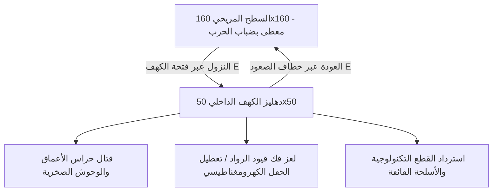
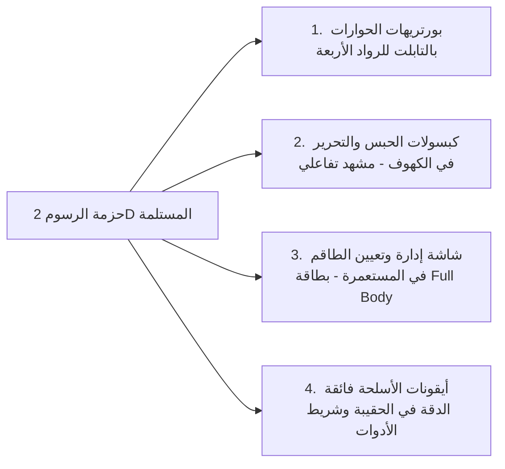

# 🪐 خطة العمل التفصيلية للمرحلة 3: دهاليز الكهوف، شبكة الماب الكبرى، تحرير الطاقم، وضباب الاستكشاف
### Subterranean Dungeons, Fog of War, Crew Rescue, & Tactical Assignments Master Plan

---

## 🗺️ 1. مناقشة ورؤية ضباب الحرب (Fog of War) وتكبير عالم المريخ

### ❓ هل نمط "ضباب الحرب الاستكشافي" (Fog of War) مناسب للعبتنا؟
> **الإجابة الحاسمة: نعم، وهو الاختيار الأمثل الذي تحتاجه اللعبة تماماً لعدة أسباب جوهرية:**

1. **العمق الجوي والرهبة المريخية (Martian Isolation & Fear of the Unknown):**
   * كوكب المريخ في قصتنا ليس متنزهاً مفتوحاً، بل بيئة خطيرة ومجهولة. رؤية كل التضاريس والكهوف منذ اللحظة الأولى تقتل متعة الاستكشاف الفضائي.
   * عندما تغطي رقعة المريخ سحابة داكنة من الثرى المريخي وضباب الغبار الناعم (**Martian Dust Shroud**)، يشعر اللاعب بوزن كل متر يقطعه خارج القاعدة، ويصبح البحث عن الكهوف مغامرة بقاء حقيقية تستنزف الأكسجين والبطارية.

2. **التكامل العبقري مع آليات اللعبة وأدواتها التكتيكية:**
   * **كشاف الخوذة والبدلة (`Flashlight`):** تشغيله يزيد نصف قطر كشف الضباب بنسبة 40% ليلاً وفي العواصف.
   * **مركبة الاستكشاف (`Ares Rover`):** كشافاتها الأمامية تكشف شريطاً استكشافياً واسعاً يزيل الضباب بسرعة، مما يجعل استخدام المركبة ضرورياً للاستكشاف البعيد.
   * **قمر ناسا المداري (`MRO Satellite Recon` عبر مفتاح H):** عند استقبال برقية استخباراتية، يقشع القمر دائرة ضباب كاملة فوق إحداثيات الكهف المكتشف!
   * **درون المسح (`Mapping Drone` في حمولة 100kg):** يمنح ميزة فورية بإزالة ضباب قطاع 60×60 حول القاعدة فور الهبوط، مما يكافئ اختيار اللاعب في شاشة التجهيز.

3. **الكفاءة التقنية وسلاسة الأداء (60 FPS Mobile Performance):**
   * يتم بناء الضباب عبر **شبكة استكشاف ثنائية الأبعاد (Exploration Grid Mask)** خفيفة جداً في الذاكرة (Byte Array لكل 2×2 متر)، مع رسم تدرج إشعاعي شعاعي ناعم (Radial Blur / Gradient) على الكانفاس.
   * الضباب في الواقع **يرفع أداء اللعبة** لأنه يتيح لنا تجاهل رسم المؤثرات الدقيقة للأشياء الواقعة في العتمة التامة خارج نطاق الرؤية.

---

### 📐 تكبير حجم الخريطة والكهوف:
* **الخريطة السطحية (Surface Planetary Map):**
  * التكبير من `100×100` بلاطة إلى **`160×160` بلاطة** (زيادة المساحة بأكثر من 250%).
  * توزيع الكهوف ومكامن الجليد في قطاعات متباعدة (تتطلب رحلات استكشافية حقيقية تتجاوز 70 إلى 120 متراً عن القاعدة).
* **خرائط الكهوف الداخلية (Subterranean Dungeons):**
  * الكهوف لم تعد مجرد حفرة سطحية 4×4، بل **خرائط دهاليز سفلية مستقلة بمساحة `45×45` إلى `50×50` بلاطة** تنزل إليها عبر مصعد الحبال والخطاف [E].



---

## 🎨 2. خطة استثمار حزمة الشخصيات والأسلحة 2D (`Free 2D Sprites`)

بعد فحص مجلد الملحقات `ملحقات/Free 2D Animated Vector Game Character Sprites`:
* وجدنا مجلدات لشخصيات كاملة (`Char 1`, `Char 2`, `Char 3`, `Char 4`) وأعداء (`Enemy 1` إلى `Enemy 4`) وأسلحة (`weaponR1`, `weaponR2`, `weaponR3`).
* نظراً لأن اللعبة تعتمد منظوراً علوياً (Top-Down 2D) في حركة اللاعب بالكانفاس، فإن هذه الرسوم الجانبية فائقة الجودة والمتجهة (Vector) ستُستغل في **المواضع التي تبرز روعتها وفخامتها دون تشويه المنظور**:



### 🎯 التوزيع المعتمد للشخصيات والأسلحة:
1. **`Char 1` (البدلة القيادية البيضاء والزرقاء):** القائد (العقيد صلاح / Commander).
2. **`Char 2` (البدلة الحيوية الخضراء):** المهندسة الزراعية مايا (Maya — Biosphere Specialist).
3. **`Char 3` (البدلة التعدينية الصفراء/البرتقالية):** الجيولوجي عمر (Omar — Mineral & Energy Specialist).
4. **`Char 4` (البدلة الطبية الرمادية والبنفسجية):** الدكتورة لينا (Lina — Chief Medical Officer).
5. **`Enemies` (الأعداء والضواري):** حراس الكهوف، وبورتريهات وحش المعقل وزعماء الألفا.
6. **`Weapons` (`weaponR1-R3`):** أيقونات مسدس البلاستر القياسي، دريل التعدين النانوي، و**قاذف البلازما التعديني التجريبي الفائق**!

---

## 🏛️ 3. تفاصيل الكهوف الستة الكبرى: الأعداء، الألغاز، والرواد المقيدون

### 1️⃣ كهف 1: وكر قلب التوربين المغناطيسي (The Magnetic Turbine Nest)
* **الموقع السطحي:** قطاع [36, 120] — عمق -120 متراً.
* **البيئة الداخلية:** صخور بركانية متوهجة، شرايين حرارية دافئة تحت الأرض وسط صقيع المريخ.
* **الزعيم والحراس:** **تيتان الحفارين المدرع (Armored Burrower Titan)** محاط بحفارين صغار لا يهاجمون إلا إذا اقتربت من المركز.
* **اللغز والصدمة السردية (The "Oh..." Moment):**
  * التوربين الضخم لا تستخدمه الكائنات كسلاح؛ بل تم جره لمركز الوكر ويعمل كمدفأة حيوية تنقذ مئات اليرقات والبيوض المضيئة من التجمد في برودة -90°C!
  * **معضلة اللاعب:** سحب التوربين فوراً يطلق إنذاراً وصراخاً هائلاً ويجبر التيتان على الهجوم دفاعاً عن يرقاته.
* **المكافأة:** **قلب توربين آريس-1 المغناطيسي (`turbine_core`)** + 2 أنوية زينو فائقة ⚛️.

---

### 2️⃣ كهف 2: صدع المهندسة الزراعية مايا (Maya's Bioluminescent Grotto)
* **الموقع السطحي:** قطاع [125, 45] — عمق -45 متراً.
* **البيئة الداخلية:** شبكة فطرية مريخية عملاقة مضيئة ذات أبواغ فسفورية خضراء متداخلة مع جذور قبة زراعية سقطت أثناء التحطم.
* **الرائد المقيد:** **مايا (Maya)** محاصرة داخل شرنقة حيوية متكافلة من الجذور الفطرية؛ الأبواغ تمدها بالأكسجين لكنها تشل أطرافها وتمنعها من الحركة.
* **لغز التحرير (Bio-Harmonic Frequency Puzzle):**
  * توجد 3 عقد فطرية طنانة (Resonance Nodes) حول الشرنقة.
  * يجب على اللاعب ضبط تردد مستشعر الحرارة في البدلة (عبر تفاعل [E]) ليتطابق مع وميض العقد بالترتيب المناسب لتفكيك الجذور بأمان دون تسميم مايا.
* **حوار التحرير الفلسفي:**
  > *"القائد صلاح؟! ظننت أنني أهذي... اسمعني، هذه الفطريات لم تكن تهاجمني؛ لقد أبقتني حية طوال 12 يوماً وشاركتني أكسجينها! المريخ ليس كوكباً ميتاً كما أخبرتنا الأرض... إنه يتنفس!"*
* **المكافأة:** تحرير مايا + **عينة مايا النباتية المقاومة للصقيع (`maya_sample`)**.

---

### 3️⃣ كهف 3: مغارة الجيولوجي عمر الكهرومغناطيسية (Omar's Resonant Cavern)
* **الموقع السطحي:** قطاع [130, 130] — عمق -85 متراً.
* **البيئة الداخلية:** أعمدة بلورية شاهقة مشحونة بطاقة كهروستاتيكية، أقواس شرر بلازما زرقاء تومض في الفراغ.
* **الرائد المقيد:** **عمر (Omar)** محتجز خلف حقل بلوري رنيني واقٍ شيده بنفسه لحماية نفسه من وحوش البلازما، لكن مولد الشحنة تعطل وحبسه في الداخل مع تناقص بطارية بدلتها لـ 5%!
* **لغز التحرير (Polarity Overload Puzzle):**
  * مواجهة وحوش بلورات البلازما وحصد شحناتهم.
  * إعادة توجيه 3 محولات أقطاب كهرومغناطيسية لتفريغ الشحنة الزائدة في صخور التأريض وعكس قطبية الحقل لفتحه.
* **حوار التحرير الفلسفي:**
  > *"في الوقت المناسب يا قائد! انظر لهذه البلورات... إنها ليست مجرد معادن صامتة؛ إنها شبكة أعصاب كوكبية تخزن الطاقة الحرارية لقلب المريخ. إذا قامت الأرض بتعدينها جائراً لإنقاذ مدنها، ستنهار القشرة وسيموت المريخ بيئياً إلى الأبد!"*
* **المكافأة:** تحرير عمر + **مكثف عمر الرنيني الفائق (`omar_geode`)**.

---

### 4️⃣ كهف 4: سرداب الطبيبة لينا الجليدي (Lina's Sub-Zero Cryo Crypt)
* **الموقع السطحي:** قطاع [40, 35] — عمق -60 متراً.
* **البيئة الداخلية:** مغارة جليدية مائية شديدة البرودة (-115°C)، أعمدة جليد زرقاء وبحيرات نيتروجين سائل.
* **الرائد المقيد:** **الدكتورة لينا (Lina)** متجمدة جزئياً داخل كبسولة نجاة طبية طارئة محاطة بجليد صلب وشبه غائبة عن الوعي من شدة الصقيع، مع وحوش الحفارين الجليديين المتربصين بالكبسولة.
* **لغز التحرير (Cryo-Thawing Defrost Sequence):**
  * هزيمة حراس الصقيع وسحب بطارياتهم المشحونة.
  * توصيل قنوات الطاقة الحرارية الثلاث بالكبسولة ورفع درجة حرارة الحاضنة تدريجياً لمنع الصدمة الحرارية لقلبها.
* **حوار التحرير الفلسفي:**
  > *"صلاح... أين البقية؟ أين آدم؟... هل تعلم ما الذي يرعبني حقاً؟ كان بإمكان تلك الكائنات تحطيم كبسولتي في ثوانٍ منذ أسبوع، لكنها لم تفعل! وفي المقابل: أين ذهب آدم؟ كيف تركنا هنا واختفى بأجهزة الاتصال؟"*
* **المكافأة:** تحرير لينا + **مرحل لينا الترددي المشفر (`lina_log`)**.

---

### 5️⃣ كهف 5: مستودع السلاح التكنولوجي الفائق (The Prototype Arsenal Depot)
* **الموقع السطحي:** قطاع [95, 140] — عمق -95 متراً.
* **طبيعة الكهف:** ليس تابعاً للطاقم؛ بل هو موقع سقوط كبسولة عسكرية سرية تابعة لمشروع أبحاث الدفاع المتقدمة للأرض (DARPA / Earth Black Ops Project).
* **الوحش الحارس:** **الغول الصخري البازلتي (Basaltic Golem Behemoth)** ذو تدريع صخري لا تؤثر فيه طلقات البلاستر العادية.
* **اللغز والتكتيك:** استدراج الوحش ليصطدم بأعمدة الشحن الحراري المتصدعة لإسقاط درعه ثم القضاء عليه.
* **المكافأة:** **قاذف البلازما التعديني التجريبي (Ares Experimental Heavy Plasma Emitter)**:
  * سلاح خارق للدروع الصخرية.
  * يستهلك طاقة بطارية أكبر ويسخن بسرعة، لكنه يدمر زعماء الألفا والتيتان بضربات مدمرة!
  * أيقونته مأخوذة مباشرة من صور `Weapons/weaponR1.png` الفخمة في حزمة الملحقات!

---

### 6️⃣ كهف 6: معقل آدم المترف السحيق (Adam's Sealed Citadel — Act IV)
* **الموقع:** أقصى شمال غرب الخريطة [15, 15] في أعمق صدع جيولوجي.
* **المعركة:** حارس المعقل المهجن (*The Apex Chimera Boss*).
* **الصدمة الكبرى:** دخول قاعة تكنولوجية مضيئة وفاخرة والعثور على آدم بكامل صحته، وتفجير المواجهة الفلسفية الكبرى للعبة (كما تم توثيقه في المخطط السردي).

---

## 👥 4. شاشة إدارة وتوظيف أفراد الطاقم في التابلت (Mobile Crew Management)

بعد تحرير كل رائد فضاء من كهفه، ينضم إلى طاقم القاعدة وتُفتح له بطاقة خاصة في تبويب **`Crew (الطاقم)`** داخل التابلت التكتيكي:

```
┌─────────────────────────────────────────────────────────────────┐
│ 👥 طاقم المستعمرة الميداني (COLONY CREW MANIFEST)               │
├────────────────────────────────┬────────────────────────────────┤
│ [صورة Full Body من حزمة 2D]    │ 👩‍🌾 د. مايا ناصر (الحياة والبيئة) │
│ الحالة: محررة ونشطة (صحة: 100%)│ التكليف الحالي: [🌿 القبة الحيوية]│
│ ────────────────────────────── │ ────────────────────────────── │
│ التأثير الإنتاجي النشط:        │ مهام التوظيف المتاحة:           │
│ • إنتاج الغذاء: +100% (مضاعف)   │ 🔘 إدارة القبة الحيوية (طعام)   │
│ • ترشيد استهلاك المياه: -40%    │ ⚪ إدارة وحدة تنقية الأكسجين     │
│ • مناعة المحاصيل ضد البرودة     │ ⚪ مستشار الاستكشاف البيئي      │
└────────────────────────────────┴────────────────────────────────┘
```

### 💼 الوظائف الميدانية لكل رائد فضاء وتأثيراتها الحقيقية:
| رائد الفضاء | المنشأة المثالية للتكليف | الفائدة الميكانيكية التكتيكية في اللعبة |
| :--- | :--- | :--- |
| 👩‍🌾 **مايا (Maya)** | **القبة الزراعية (Biodome)** | مضاعفة نمو المحاصيل بنسبة **+100%**، خفض استهلاك المياه بنسبة **40%**، ومناعة ضد موت النباتات في موجات الصقيع. |
| 👨‍🔬 **عمر (Omar)** | **مصفاة التعدين والمصاهر (Refinery)** | زيادة استخراج صخور الريجوليث والجليد بنسبة **+50%**، وتخفيض تكلفة صناعة ألواح الطاقة والبطاريات. |
| 👩‍⚕️ **لينا (Lina)** | **الوحدة الطبية وعزل البدلة (Med-Bay)** | استعادة مستمرة للصحة النفسية (`Sanity +1.5/s`)، علاج تلقائي للنزيف والإصابات، وتخفيض استهلاك الأكسجين أثناء السكون. |
| 👨‍🔧 **آدم (Adam)** *(بعد Act IV)* | **منصة الإطلاق ومولدات MAV** | زيادة إنتاج شبكة الطاقة بنسبة **+50%**، وإنجاز برمجة حاسوب الملاحة وتصنيع مركبة الهروب MAV. |

---

## 📡 5. برقيات الأرض السردية الموجهة لخدمة فلسفة "الميزان الأحمر"

مع الرسايل العشوائية للاستخبارات، يتم حقن **برقيات أرضية ذات مغزى سردي عميق** تعزز فلسفة الصراع المشروعة:

1. **برقية الأرض 1 (Sol 07 — أزمة الصقيع والمجاعة على الأرض):**
   > *"هيوستن إلى القائد صلاح: صور الأقمار الصناعية تظهر موجة صقيع قاري تجتاح أوروبا وشمال آسيا. شبكات الطاقة الأرضية تنهار، ودرجات الحرارة في العواصم بلغت -25°C بدون وقود تدفئة. الملايين في الملاجئ ينتظرون شحنات بلورات زينو الحرارية. أنت لا تنقذ نفسك فقط يا صلاح... أنت تحمل دفء 8 مليارات إنسان."*
2. **برقية الأرض 2 (Sol 14 — أوامر سرية مشبوهة حول العينات):**
   > *"توجيه خاص ومشفر من القيادة العليا: رصدنا تقلبات في انبعاثات الكائنات حول قطاعكم. نكرر الأمر: الأولوية القصوى للأمن القومي هي تأمين الأنسجة الحيوية وأنوية الزينو لدراسة تكيفها مع البرد. لا تضيع الوقت في محاولات التواصل؛ المريخ مورد للبشرية، والبقاء للأصلح."*
3. **برقية الأرض 3 (Sol 21 — استفسار مريب عن المهندس آدم):**
   > *"هيوستن: حللنا السجلات الأخيرة لمركبة آريس-1 قبل انقطاع البث. المهندس آدم كان يعارض خطة إرسال شحنات التعدين للأرض بشدة قبل الكارثة بيومين وادعى أن ذلك 'سيقتل روح المريخ'. إذا عثرت على أي من مذكراته أو أجهزته، انقل بياناتها لقنواتنا المشفرة فوراً ولا تفتحها."*

---

## 📋 6. مراحل التنفيذ التفصيلية وبروتوكولات الاختبار الميداني (Milestones & QA Testing Protocols)

تم تقسيم تطوير المرحلة 3 إلى **5 محطات تنفيذية متسلسلة ودقيقة (Milestones 3A to 3E)** مع تحديد خطوات العمل الدقيقة وبروتوكول الفحص والاختبار لكل محطة:

---

### 🏁 المحطة 3A: توسيع عالم المريخ السطحي (160×160) ومحرك ضباب الحرب (Fog of War)
> **الهدف:** مضاعفة مساحة العالم لخلق شعور حقيقي بالاستكشاف، وتطبيق ضباب الحرب الاستكشافي المتكامل مع الكشاف، المركبة، الرادار، والدرون.

#### 🔨 مهام التنفيذ البرمجية:
1. **توسيع أبعاد الخريطة السطحية (`gridHelpers.js` & `gameTypes.js`):**
   * تغيير أبعاد شبكة المريخ من `100×100` إلى **`160×160` بلاطة**.
   * إعادة ضبط موقع هبوط المركبة والقاعدة في المركز `[80, 80]`.
   * إعادة توزيع الكهوف الستة ومكامن الجليد النادرة في قطاعات أطراف الكوكب البعيدة (مسافات بين 70 و 120 متراً).
2. **محرك ضباب الحرب الاستكشافي (`FogOfWarManager` في `CanvasView.jsx`):**
   * إنشاء مصفوفة استكشاف خفيفة `exploredGrid` (بأبعاد الشبكة) تحفظ البلاطات التي زارها أو كشفها اللاعب (`Fog Memory`).
   * رسم طبقة قناع داكنة وضباب غباري مريخي ناعم بتدرج إشعاعي (Radial Gradient Mask) حول رائد الفضاء.
   * ضبط نصف قطر الرؤية:
     - الوضع العادي مشياً: 12 متراً.
     - مع تشغيل كشاف البدلة `[F]`: 18 متراً (+50%).
     - داخل مركبة آريس `[Rover]`: 26 متراً مع كشاف إضاءة مخروطي أمامي بعيد المدى.
     - درون المسح (`mapping_drone`): كشف فوري لقطاع 60×60 حول القاعدة عند الهبوط.
     - قمر ناسا المداري (`MRO Recon`): قشع بؤرة ضباب دائرية فوق الكهف المكتشف فور تلقي برقية هيوستن.
3. **تحديث الرادار والمينيماب (`Minimap.jsx`):**
   * إظهار المناطق غير المستكشفة بعتمة تكتيكية وتحديث الخريطة الشاملة بما تم استكشافه فقط.

#### 🧪 بروتوكول فحص واختبار المحطة 3A (QA Protocol):
* [x] **فحص سلامة البناء:** تشغيل `npm run build` والتحقق من عدم وجود أي خطأ برمجي (تم البناء بنجاح 0 errors في 14.61s).
* [x] **فحص انقشاع الضباب (Fog Dissipation):** المشي على السطح والتحقق من ذوبان الضباب بنعومة وتثبيت المناطق المستكشفة في الذاكرة (Fog Memory).
* [x] **فحص أدوات الإضاءة:** الضغط على مفتاح `F` وتشغيل الكشاف وملاحظة اتساع دائرة الرؤية فورياً (+50% إلى 18 متراً).
* [x] **فحص استقرار الإطارات (60 FPS):** مراقبة أداء الكانفاس والتأكد من ثباته على 60 FPS باستخدام قناع الكانفاس المنفصل ومصفوفة Uint8Array الفائقة السرعة.

---

### 🏁 المحطة 3B: محرك الدهاليز السفلية ونظام الانتقال السلس للكهوف (Subterranean Dungeon Engine)
> **الهدف:** تحويل الكهوف إلى بيئات سفلية مستقلة بمساحة 50×50 تنزل إليها بمصعد الحبال وتعود منها للسطح.

#### 🔨 مهام التنفيذ البرمجية:
1. **مدير المستويات السفلية (`subterraneanManager.js`):**
   * خوارزمية توليد وتخزين خرائط الكهوف الداخلية الستة بمساحة `50×50` بلاطة بجدران بازلتية، ممرات، وقاعات مركزية.
   * حالة المستوى: `currentLevel: 'SURFACE' | 'CAVE_TURBINE' | 'CAVE_MAYA' | 'CAVE_OMAR' | 'CAVE_LINA' | 'CAVE_ARSENAL' | 'CAVE_ADAM'`.
2. **آلية الانتقال السلس بالصوت والمؤثرات (Cave Transition):**
   * عند الاقتراب من فتحة الكهف على السطح يظهر مؤشر `[E] النزول لدهليز الكهف`.
   * شاشة انتقال سينمائية سوداء سريعة (Fade to Black) مع صوت هبوط كبلي وتأثير صوتي لصدى الرياح السحيقة.
   * توليد نقطة خروج بمصعد هيدروليكي `[E] الصعود إلى سطح المريخ`.
3. **فيزياء صقيع الأعماق (Subterranean Deep Frost):**
   * داخل الكهف: درجة الحرارة تنخفض لـ -110°C، واستهلاك البطارية يرتفع بمقدار +50% لتشغيل تدفئة البدلة.
   * ضباب رطوبي داخلي مع إضاءة فسفورية تنبعث من الصخور وحضانات الكائنات.

#### 🧪 بروتوكول فحص واختبار المحطة 3B (QA Protocol):
* [ ] **فحص الدخول والخروج:** الوقوف عند مدخل الكهف والنزول بـ `[E]` ثم العودة بـ `[E]` والتأكد من العودة لنفس الإحداثيات السطحية الدقيقة.
* [ ] **فحص ثبات الحالة (State Persistence):** التأكد من عدم ضياع أي مورد أو أكسجين أو بطارية أثناء التنقل بين السطح والكهف.
* [ ] **فحص استهلاك التدفئة:** مراقبة عداد البطارية والتأكد من ارتفاع معدل استهلاك التدفئة داخل الدهليز.

---

### 🏁 المحطة 3C: تصميم وبرمجة الكهوف الستة الكبرى (الأعداء، الألغاز، والرواد المقيدون)
> **الهدف:** بناء التحدي الحقيقي في كل كهف؛ قتال الحراس، فك الألغاز التفاعلية لكسر قيود الرواد، وحصد القطع الأسطورية.

#### 🔨 مهام التنفيذ البرمجية:
1. **كهف 1 (وكر التوربين):** تيتان الحفارين، معضلة سحب التوربين من حضانة اليرقات الدافئة، واسترداد `turbine_core`.
2. **كهف 2 (صدع مايا):** مايا محاصرة في الجذور الفطرية، لغز ضبط التردد الحراري لـ 3 عقد بمستشعر البدلة، وتحرير مايا وعينتها النباتية `maya_sample`.
3. **كهف 3 (مغارة عمر):** عمر محتجز خلف حقل بلوري، لغز محولات الأقطاب الكهرومغناطيسية وتفريغ الشحنات، وتحرير عمر ومكثفه `omar_geode`.
4. **كهف 4 (سرداب لينا):** لينا متجمدة داخل كبسولة نجاة طبية، لغز توصيل قنوات الطاقة وإذابة الجليد تدريجياً، وتحرير لينا ومفتاحها المشفر `lina_log`.
5. **كهف 5 (مستودع السلاح الفائق):** مواجهة الغول الصخري البازلتي، استدراجه لأعمدة الشحن، واسترداد **قاذف البلازما التعديني التجريبي (Ares Heavy Plasma Emitter)**.
6. **كهف 6 (معقل آدم):** حارس المعقل المهجن، دخول القاعة المتطورة المترفة، وتفجير المواجهة الفلسفية الكبرى للقصة.

#### 🧪 بروتوكول فحص واختبار المحطة 3C (QA Protocol):
* [ ] **فحص قتال الزعماء:** مواجهة تيتان الكهف والغول الصخري والتحقق من دقة نقاط الإصابة (Hitboxes) والضرر.
* [ ] **فحص منطق الألغاز:** تجربة التفاعل مع مفاتيح كل لغز والتحقق من عدم فتح القيود إلا بعد اكتمال التسلسل الصحيح.
* [ ] **فحص استلام القطع:** التحقق من ظهور إشعار الاسترداد وإضافة القطع (`CAVE_RELICS`) للحقيبة ومزامنتها مع أهداف تصنيع MAV.

---

### 🏁 المحطة 3D: دمج حزمة الرسوم 2D والأسلحة والواجهات السينمائية
> **الهدف:** دمج ملفات الرسوم والأسلحة المرفقة كبورتريهات حوارية، كبسولات حية للأسرى، وأيقونات أسلحة فائقة الدقة.

#### 🔨 مهام التنفيذ البرمجية:
1. **استيراد ومعالجة الرسوم (`src/assets/sprites/`):**
   * استخراج البورتريهات السينمائية (`Char 1` للقائد، `Char 2` لمايا، `Char 3` لعمر، `Char 4` للينا).
   * استخراج أيقونات الأسلحة (`Weapons/weaponR1.png` و `weaponR2.png`).
2. **واجهة فحص كبسولة الرائد المقيد داخل الكهف (`CaptiveRescueModal.jsx`):**
   * عند الضغط على `[E]` بجانب الرائد المقيد، تفتح نافذة تفاعلية هولوجرافية تعرض صورة الشخصية (Full Body) مقيدة بالأصفاد أو الجذور مع نص حواره وصوته وحالة نبضه وأزرار فك اللغز.
3. **تفعيل قاذف البلازما التجريبي الجديد في اليد والكانفاس:**
   * سلاح جديد يظهر في شريط الأدوات بأيقونة `weaponR1.png` الفخمة.
   * إطلاق مقذوفات بلازما زرقاء عملاقة تخترق دروع الصخور وتسبب ضرراً مضاعفاً (+250%) للوحوش الكبيرة مع استهلاك 5 kWh طاقة لكل طلقة.

#### 🧪 بروتوكول فحص واختبار المحطة 3D (QA Protocol):
* [ ] **فحص دقة ووضوح الرسوم:** التأكد من تحميل صور الشخصيات والأسلحة دون أي تشويه أو بطء.
* [ ] **فحص تجاوب واجهة التحرير:** اختبار نافذة تحرير الرائد المقيد على أبعاد شاشات الموبايل والتأكد من سلاسة التفاعل.
* [ ] **فحص إطلاق سلاح البلازما:** إطلاق النار بالسلاح الجديد والتحقق من شكل المقذوف، استهلاك البطارية، وتدمير دروع الأعداء.

---

### 🏁 المحطة 3E: شاشة توظيف الطاقم بالموبايل وحقن برقيات الأرض السردية
> **الهدف:** إدارة المستعمرة بالرواد المحررين، وتفعيل برقيات الأرض السردية المؤثرة في أيامها المحددة.

#### 🔨 مهام التنفيذ البرمجية:
1. **تبويب إدارة وتعيين الطاقم بالتابلت (`CrewManagementTab.jsx`):**
   * تصميم تبويب جديد داخل التابلت التكتيكي مخصص لإدارة الرواد المحررين.
   * إمكانية تكليف كل رائد بمنشأته المثالية بضغطة زر:
     - مايا ➔ القبة الزراعية (+100% طعام، -40% ماء).
     - عمر ➔ المصفاة والمصاهر (+50% استخراج ريجوليث وجليد، -25% تكلفة بطاريات).
     - لينا ➔ الوحدة الطبية (استعادة مستمرة للصحة النفسية `+1.5/s`، علاج تلقائي للنزيف).
2. **برقيات الأرض السردية الثلاثية الموجهة (`callEarth`):**
   * في Sol 7: برقية أزمة الصقيع والمجاعة ومأساة الـ 8 مليارات إنسان على الأرض.
   * في Sol 14: التوجيه السري المشبوه بحصد العينات الحيوية وأنوية الزينو للأمن القومي.
   * في Sol 21: التحذير الاستخباراتي المريب من أفكار المهندس آدم.
3. **الفحص والتجميع النهائي الشامل للمرحلة 3:**
   * تشغيل البناء الكامل `npm run build` والتحقق من 0 أخطاء و 0 تحذيرات.

#### 🧪 بروتوكول فحص واختبار المحطة 3E (QA Protocol):
* [ ] **فحص مضاعفات الإنتاج:** تعيين مايا بالقبة ومراقبة تضاعف سرعة نمو المحاصيل، وتعيين لينا وملاحظة ارتفاع الصحة النفسية.
* [ ] **فحص تسلسل برقيات الأرض:** الاتصال بالأرض في Sol 7 و 14 و 21 والتحقق من استلام البرقيات السردية بنصوصها الدقيقة.
* [ ] **فحص دورة اللعب المتكاملة (Full Gameplay Loop Test):** تجربة لعبة جديدة: الهبوط وسط الضباب، استكشاف السطح بالمركبة، نزول أول كهف، حل اللغز وتحرير الرائد، وتوظيفه في القاعدة بنجاح.

---

> 📁 **ملاحظة:** تم تحديث وتوثيق هذا الدليل التنفيذي الكامل داخل مستند المشروع:  
> [`PHASE3_SUBTERRANEAN_PLAN.md`](file:///e:/salah/salah_programing/space_game/PHASE3_SUBTERRANEAN_PLAN.md)
