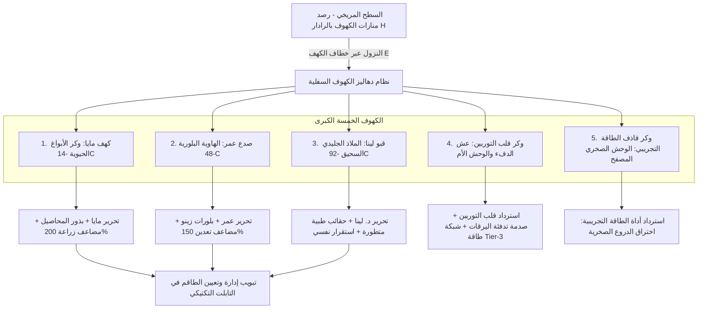

# 🚀 خطة تنفيذ المرحلة 3: دهاليز الكهوف، تحرير الطاقم، قلب التوربين، والأداة التجريبية
### Phase 3 Execution Plan: Subterranean Caverns, Crew Rescue, Turbine Core, & Experimental Tech

---

## 📋 نظرة عامة والهدف الاستراتيجي (Strategic Overview)
تعتبر **المرحلة 3** النقلة الكبرى في تجربة لعبة *Astra: The Red Balance*؛ حيث تنتقل اللعبة من مجرد بقاء وتعدين سطحي إلى **استكشاف دهاليز سفلية حقيقية (Subterranean Dungeon Crawling)**، تتكشف خلالها خيوط القصة الفلسفية، وتتحقق أهداف إنقاذ طاقم بعثة آريس-1 (مايا، عمر، لينا)، واسترداد التكنولوجيا الفائقة (قلب التوربين التدفئي، وقاذف الطاقة التجريبي الخارق للدروع).

---

## 🛠️ تفاصيل حزم العمل الخمس (Work Packages)

### 📌 حزمة العمل 3.1: البنية التحتية لنظام النزول والصعود والانتقال السلس (Dungeon Transition Engine)
* **المسار الحالي:** رصد الكهوف عبر إشارات ناسا المدارية وظهور أعمدة الضوء الهولوجرافية على الكانفاس.
* **المهام البرمجية:**
  1. عند وقوف اللاعب فوق فتحة الكهف ومواجهته لها، يظهر زر تفاعل نيون: `[E] النزول إلى أعماق الكهف`.
  2. حفظ موقع اللاعب السطحي بدقة (`surfacePosRef`) وحفظ كافة مؤشراته الحيوية والبطارية والعتاد.
  3. تفعيل مشهد انتقال سينمائي سريع (صوت سحب ونش الكابلات المعدنية + شاشة تعتيم فضائية سلسة).
  4. تحميل خريطة الكهف الداخلية (شبكة `20×20` أو `30×30` مصممة بخصائص بيئية مميزة عبر `caveGenerator.js`).
  5. وضع نقطة صعود آمنة (`Exit Hoist`) تتيح للاعب العودة للسطح بنفس موقعه عند ضغط `[E] صعود للسطح`.
  6. تطبيق فيزياء الكهوف: انقطاع الطاقة الشمسية كلياً (الاعتماد التام على البطاريات)، تأثر حرارة البدلة بحرارة الكهف الداخلية، وإضاءة مخروط كشاف الخوذة في الظلام السحيق.

---

### 📌 حزمة العمل 3.2: كهوف الطاقم الثلاثة وحوارات التحرير السردية (Crew Rescue Caverns)

#### 1. كهف مايا (Maya's Spore Grotto — -14°C):
* **البيئة والمؤثرات:** كهف رطب ذو إضاءة بنفسجية حيوية، أبواغ مشعة (`Spore Clusters`)، وجذور مريخية عضوية.
* **التحدي:** زواحف الأبواغ المضيئة (Spore Burrowers) وحقول عوائق حيوية تتطلب التدمير بالبلاستر أو الحرق.
* **حدث التحرير:** العثور على كبسولة طوارئ مايا محاصرة بين الجذور الحيوية.
* **البعد السردي واللور:** مايا تكشف أن الجذور تتفاعل مع الكائنات دون عداء، وتبدي قلقها وحزنها على مصير آدم:
  > *"آدم خاطر بحياته لإغلاق صمامات التدفئة وإنقاذنا... أرجوك أخبرني، هل عثرتم على جثته؟"*
* **المكافأة:** عودة مايا للقاعدة + فتح زراعة المحاصيل المتقدمة في القبة الحيوية بمضاعف إنتاج 200%.

#### 2. صدع عمر (Omar's Crystalline Chasm — -48°C):
* **البيئة والمؤثرات:** صدع بازلتي عميق ذو رنين كهرومغناطيسي وأعمدة بلورات زينو صفراء وذهبية عملاقة تنبض بالكهرباء الحرارية.
* **التحدي:** حراس البلورات (Crystal Walkers) يطلقون شحنات كهرضغطية في مسارات مستقيمة.
* **حدث التحرير:** كبسولة عمر محاصرة داخل فالق بلوري يستلزم تكسير 3 أعمدة رنين مشحونة لفك الحقل الكهرومغناطيسي.
* **البعد السردي واللور:** عمر يفسر الحقيقة الجيولوجية:
  > *"هذه البلورات ليست أحجاراً ميتة لتباع على الأرض... إنها شرايين التدفئة الوحيدة التي تحمي المريخ من الموت البيئي التام!"*
* **المكافأة:** عودة عمر للقاعدة + حزمة بلورات زينو نقية + مضاعف ناتج التعدين بنسبة 150%.

#### 3. قبو لينا الجليدي (Lina's Sub-Zero Crypt — -92°C):
* **البيئة والمؤثرات:** كهف جليدي سحيق تحت -90 مئوية، ثلوج أزلية زرقاء، وتآكل سريع لحرارة البدلة ما لم يستهلك اللاعب بطاريته للتدفئة.
* **التحدي:** كائنات جليدية ضارية سريعة، ومسارات صقيع تسبب انزلاقاً خفيفاً.
* **حدث التحرير:** كبسولة الحفظ بالتبريد للدكتورة لينا.
* **البعد السردي واللور:** سؤال لينا الصادم الذي يهز قناعات القائد:
  > *"كان بإمكان الكائنات تمزيقنا في الليلة الأولى... فلماذا حاصرتنا في البرد فقط؟ وكيف استطاع آدم أن ينام هانئاً ونحن نختنق في الصقيع؟"*
* **المكافأة:** عودة د. لينا للقاعدة + أمبولات علاج متقدمة + تثبيت مؤشر الصحة النفسية ومنع الهلاوس.

---

### 📌 حزمة العمل 3.3: وكر قلب التوربين ولحظة "Oh..." السردية (The Turbine Core Nest & Titan Boss)
* **البيئة:** جيب بركاني دافئ (+24°C) وسط جليد المريخ.
* **المشهد الصادم:** في وسط الكهف يستقر محرك قلب التوربين المفقود من آريس-1... وحوله يرقات كائنات صغيرة تدفئ أجسادها حول الحرارة بسلام تام.
* **زعيم الكهف:** **تيتان الحفارين (Titan Broodmother)** — وحش ضخم يخرج من الأرض للدفاع عن صغاره ومصدر حرارتهم الوحيد.
* **آلية المعركة:**
  * الوحش يملك درعاً صخرياً وهجمات ارتطام زلزالية.
  * نقاط ضعف في الحلق والبطن عند تجهيز ضربة الارتطام.
* **القرار واللحظة السردية:** استرداد قلب التوربين وإدراك أن الكائنات لم "تسرق" التوربين كسلاح أو لؤم، بل سحبته كمدفأة حيوية لإنقاذ صغارها من الموت تجمداً في صقيع -90°C!
* **الأثر التقني بالقاعدة:** تركيب قلب التوربين في شبكة المستعمرة يعيد تشغيل شبكة الطاقة الفائقة (Tier-3 Reactor Grid) ويوفر طاقة كافية لبناء مركبة MAV لاحقاً.

---

### 📌 حزمة العمل 3.4: وكر أداة الطاقة التعدينية التجريبية (Experimental High-Energy Emitter)
* **البيئة:** مغارة بازلتية شديدة القسوة تعج بصخور فولاذية منيعة على الدريل العادي.
* **التحدي والزعيم:** كائن بازلتي مصفح بدرع منيع يرتد عنه البلاستر العادي.
* **المكافأة:** استرداد **قاذف الطاقة الكهرومغناطيسي التجريبي (Ares Experimental High-Energy Emitter)**:
  * أداة علمية مزدوجة (تعدين فائق + سلاح خارق للدروع).
  * **الميزات:** يذيب الدروع الصخرية السميكة للأعداء بضرر هائل (+150%) ويستخرج الخامات بضربة واحدة.
  * **الموازنة الواقعية:** استنزاف مرتفع لبطارية البدلة (High Battery Drain)، ومؤشر حرارة (Heat Gauge) يتطلب فترة تبريد لمنع تعطل الأداة.

---

### 📌 حزمة العمل 3.5: واجهة إدارة الطاقم المحرر في التابلت (Tactical Crew Roster)
* **المسار:** إضافة قسم مخصص في التابلت التكتيكي: `طاقم آريس-1 المحرر (Ares-I Crew Roster)`.
* **العناصر:**
  1. بطاقة تفاعلية لكل رائد فضاء محرَّر (مايا، عمر، لينا) مع صورته وتخصصه ومؤشر معنوياته.
  2. أزرار تكليف المهام اليومية:
     * **مايا:** تكليف في القبة الحيوية (إنتاج وجبات مضاعف +300% وتوفير استهلاك الجليد).
     * **عمر:** تكليف في مصفاة التعدين (زيادة ناتج الريجوليث والحديد +150%).
     * **لينا:** تكليف في العيادة (علاج تلقائي تدريجي وإلغاء استنزاف الصحة النفسية).
  3. حوارات دورية مع الرواد تعكس تطور القصة وحزنهم المستمر على آدم الذي يظنون أنه استشهد بطلاً.
  4. تقرير السول اليومي يظهر مساهمات الطاقم الميدانية بوضوح.

---

## 📅 خطة التنفيذ الميدانية خطوة بخطوة (Step-by-Step Implementation)

| الخطوة | المكون البرمجي المستهدف | الناتج المطلوب |
| :---: | :--- | :--- |
| **1** | `src/components/CanvasView.jsx` + `src/App.jsx` | برمجة زر التفاعل `[E]` على فتحات الكهوف وتفعيل الانتقال السلس إلى وضع دهليز الكهف الداخلي |
| **2** | `src/utils/caveGenerator.js` + `src/components/CaveExplorerModal.jsx` | ضبط خرائط الدهاليز السفلية، العوائق البيئية، ونقاط حبال الصعود للسطح |
| **3** | `src/components/TacticalTabletModal.jsx` | إضافة تبويب إدارة وتكليف الطاقم المحرر (مايا، عمر، لينا) وربط مضاعفات الإنتاج اليومية |
| **4** | `src/hooks/useGameLoop.js` | تطبيق مضاعفات الطاقم على إنتاج المزارع والتعدين واستهلاك الصحة والبطارية |
| **5** | `src/components/CanvasView.jsx` | برمجة زعيم وكر التوربين تيتان الحفارين، واسترداد قلب التوربين والأداة التجريبية الخارقة للدروع |
| **6** | `QA Testing & Build` | اختبار فحص الدخول والخروج من الكهوف، فحص توازن الطاقة والقتال، وبناء المشروع بدون أخطاء |

---

## 🧪 بروتوكول الفحص والاختبار (Phase 3 QA Protocol)
1. **فحص النزول والصعود (Seamless Dungeon Transition):** النزول لجميع الكهوف الخمسة والعودة للسطح دون فقدان طاقة البدلة أو الموارد المحمولة.
2. **فحص تحرير الطاقم (Crew Rescue Trigger):** فك قيود كبسولات مايا وعمر ولينا، وانتقالهم الآمن للقاعدة وتفعيل بطاقاتهم بالتابلت.
3. **فحص أداة الطاقة التجريبية (Energy Emitter Mechanics):** التحقق من مؤشر الحرارة، استنزاف البطارية، وتأثير اختراق الدروع الصخرية.
4. **فحص زعيم التوربين (Titan Boss Encounter):** سلاسة حركة الزعيم، توازن الضرر، واسترداد قلب التوربين بنجاح.
5. **فحص خلو البناء من الأخطاء (Zero-Error Production Build):** نجاح أمر `npm run build` بالكامل.

